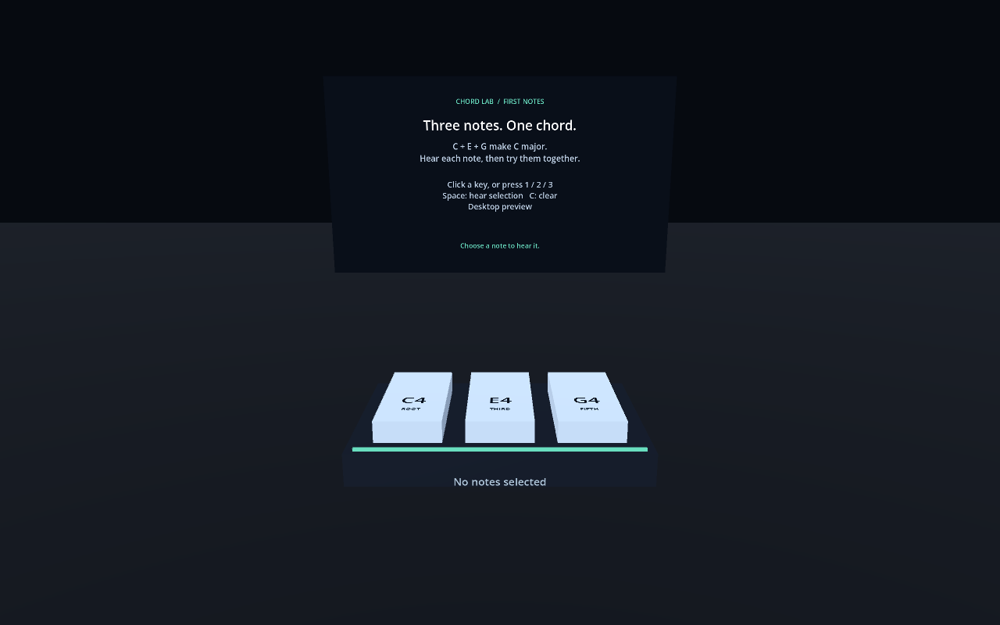

# Chord Lab

Name: Daniel Welch

Student Number: C23732441

Project for Games Engines 1 / Extended Reality

## Description of the project

Chord Lab is a small Godot mixed-reality music education project for Meta Quest. Its intended 3–5 minute experience teaches beginners how the root, third and fifth form a triad, how lowering the third changes a major chord into a minor chord, and how to build simple chords on a virtual keyboard.

**Current implementation: Milestone 1 foundation.** Three large C4, E4 and G4 targets support selection, deselection, visual feedback, individual playback, hearing the selection together, and clearing. This is an interaction prototype; the complete keyboard and lesson sequence have not been implemented. Headset validation remains pending.



## Instructions for use

1. Import `project.godot` into **Godot 4.7.2 Standard**, matching the version used for local verification.
2. Wait for the WAV assets to import, then press **F6** with `scenes/main.tscn` open or **F5** to run the project.
3. Without an initialized OpenXR runtime, the scene uses a desktop camera automatically.

| Action | Desktop preview | Quest Touch controllers |
| --- | --- | --- |
| Select/deselect a note | Click a key or press **1**, **2**, **3** | Point a ray at a key and squeeze the trigger |
| Hear selected notes together | **Space** | **A** or **X** |
| Clear selection and stop playback | **C** | **B** or **Y** |
| Place keyboard in front of the viewer | Fixed preview position | Squeeze either grip |

Selecting a note plays it; deselecting removes its highlight. Release the trigger before selecting another note. The keyboard is placed when the first valid head pose arrives, 0.8 m ahead and 0.5 m below eye level, with the instruction panel above it. Grip repositions it for a new facing direction or seated height. Actual comfort and readability require headset testing.

To force desktop mode with a headset runtime installed:

```powershell
godot --path . --xr-mode off
```

Make sure Godot is in PATH for this! Otherwise just use the full executable.

## References

- [Assignment specification and rubric](https://github.com/skooter500/xr26/blob/main/assignment.md)
- [Required README template](https://github.com/skooter500/xr26/blob/main/assignmentreadme.md)
- [Course music scene](https://github.com/skooter500/xr26/blob/main/examples/tank_game_3d/music_toys.tscn): controller/collision setup reference. Movement and sequencer features were not brought into this project.
- [Course sequencer](https://github.com/skooter500/xr26/blob/main/examples/tank_game_3d/sequencer.gd): overlapping sample playback reference. This project uses explicit sample paths rather than scanning `.import` filenames.
- [Course passthrough example](https://github.com/skooter500/xr26/blob/main/examples/bge/start_passthrough.gd): reviewed for later use; passthrough is not currently implemented.
- [Godot XR setup](https://docs.godotengine.org/en/stable/tutorials/xr/setting_up_xr.html)
- [Godot XR action maps](https://docs.godotengine.org/en/stable/tutorials/xr/xr_action_map.html)
- [Godot XR Android deployment](https://docs.godotengine.org/en/stable/tutorials/xr/deploying_to_android.html)
- [Godot Android export](https://docs.godotengine.org/en/stable/tutorials/export/exporting_for_android.html)

## What I am most proud of in the assignment

We'll see!

## What I learned

We'll see!